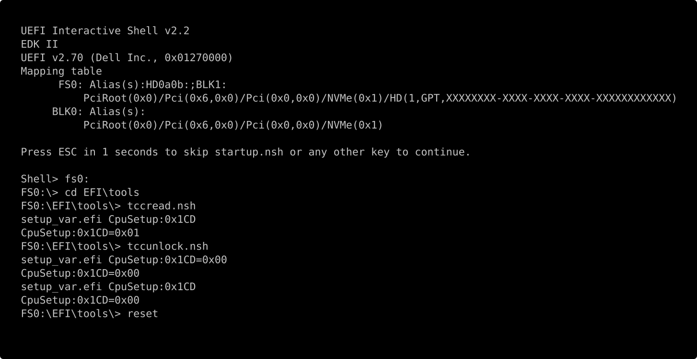

# Unlock the Intel TCC offset on Dell laptops (throttle below 100°C)

Intel CPUs throttle at TjMax, normally 100°C. The **TCC offset** lowers that threshold, and Linux
exposes it at `/sys/devices/pci0000:00/0000:00:04.0/tcc_offset_degree_celsius`: an offset of 10
gives a 90°C limit, enforced in hardware.

This makes it much more reactive than any other thermald(-like) setup (temps stay withing ~1°C of
your target temperature, even on extreme load). Software control instead can often react too late
(which can lead to your machine to shut down brutally to protect itself) and forces you to replace
your vendor temp tuning for your specific machine.

On modern Dell laptops the write fails:

```
$ echo 10 | sudo tee /sys/devices/pci0000:00/0000:00:04.0/tcc_offset_degree_celsius
tee: ...: Operation not permitted
```

The firmware sets the lock bit (bit 31) of `MSR_IA32_TEMPERATURE_TARGET` (`0x1A2`), so
[`intel_tcc_set_offset()`](https://github.com/torvalds/linux/blob/master/drivers/thermal/intel/intel_tcc.c)
returns `-EPERM`. The lock comes from a setup option, "Tcc Offset Lock Enable", that Dell stores but
does not show in its BIOS menu. `unlock.sh` clears it from a UEFI shell. Afterwards the normal
kernel interface works.

> **Before you start:** the offsets differ per model and BIOS version, so the scripts read them
> from your own BIOS image and check them against your running firmware before anything is
> written — don't reuse an offset from another machine. If a wrong byte ever does get written,
> [Recovery](#recovery) is an RTC reset that puts the BIOS back to defaults.

## Use it

```
./unlock.sh
```

It explains each step, asks before doing anything, and picks up where it left off, so you run it
twice with a reboot in between:

1. **Finds the lock option in your own BIOS.** Downloads the BIOS package matching your model and
   version from Dell's catalog, dumps its hidden setup forms, and reads the same byte from your
   running firmware to confirm the two agree.
2. **Stages a UEFI shell.** Backs up the setup variable, copies the shell and
   [setup_var.efi](https://github.com/datasone/setup_var.efi) to the EFI partition, and adds a boot
   entry for the next boot only.
3. **You clear the lock in the shell**, with two generated one-line scripts it prints for you:
   `tccread.nsh` to look, `tccunlock.nsh` to change. Anything unexpected, type `reset` and nothing
   has changed.
4. **Back in Linux, run `./unlock.sh` again.** It sets the offset, installs a systemd unit that
   restores it at every boot, and removes the boot entry and staged files.



*Step 3, reconstructed: rendered text rather than a photograph of a boot, using the line format
`setup_var.efi` actually prints. `0x01` before, `0x00` after.*

Requirements: Secure Boot off (the shell is unsigned), plus `curl`, `unzip`, `7z`, `efibootmgr`,
and `python3` with `pip`. Nothing is installed system-wide except the systemd unit in step 4.

Verified on a **Dell XPS 17 9730, BIOS 1.27.0** (i9-13900H, Ubuntu, kernel 7.0), where the option
sits at `CpuSetup:0x1CD`. The method is generic to Intel firmware using an AMI/Intel reference
`CpuSetup` varstore, but the offsets differ per model and BIOS version, which is why step 1 reads
them out of your own image.

## Check it works

Load every core and watch the package temperature:

```
stress-ng --cpu 0 --cpu-method matrixprod --timeout 180s
sudo turbostat --quiet --show PkgTmp,PkgWatt,Avg_MHz --interval 2
```

`PkgTmp` should climb and then hold at your offset below TjMax — 90°C for an offset of 10 — with
`Avg_MHz` dropping as it holds there. The hardware counter below climbs whenever the thermal
control circuit engages, so a rising count with the temperature pinned below TjMax is the offset
doing its job:

```
cat /sys/devices/system/cpu/cpu0/thermal_throttle/package_throttle_count
```

## After a BIOS update

Assume every update re-locks it: setup variables are re-created from defaults when their layout
changes between versions. "Restore defaults" in the BIOS menu and an RTC reset do the same.
`systemctl status tcc-offset.service` tells you — it fails at boot once the lock is back. Run
`./unlock.sh` again to redo it.

## Recovery

- **RTC reset:** with the laptop off and on AC, hold the power button about 30 seconds (25–40).
  This restores BIOS defaults on Dell portables.
- **BIOS recovery from the hard drive:** enabled by default on recent XPS models, using
  `EFI/dell/bios/recovery/BIOS_CUR.rcv` on the EFI partition.
- **BIOS recovery from USB:** a FAT32 stick with your model's `BIOS_IMG.rcv`, then hold Ctrl+Esc
  while connecting power. Its menu includes "Reset NVRAM".

## Files

| File | Purpose |
| --- | --- |
| `unlock.sh` | the whole procedure, one guided step at a time |
| `findoffset.sh` | the BIOS analysis on its own; prints every TCC option, its offset and live value |
| `cleanup.sh` | remove the boot entry and staged files (step 4 calls it) |

## Details

**Why a UEFI shell.** The variable is readable from Linux but not writable: `SetVariable` returns
`EFI_WRITE_PROTECTED` at runtime, which surfaces as `Read-only file system` on the `efivarfs` file.
The same write from a shell, before the OS boots, is accepted.

**Only the lock is changed in firmware.** The offset value itself is written by the systemd unit at
each boot. Dell keeps its own copy of the offset in a vendor varstore and may write it back, while
the lock byte has no such twin. Suspend needs no handling: the kernel saves the offset and restores
it on resume.

**Checking by hand.** `efivarfs` files start with 4 attribute bytes, so VarOffset `0x1CD` is at file
offset `0x1D1`. `00` means unlocked:

```
cat /sys/firmware/efi/efivars/CpuSetup-*  | od -An -tx1 -j 0x1d1 -N1
```

**License:** public domain, see [UNLICENSE](UNLICENSE).

**Inspecting a BIOS without touching the machine:** `./findoffset.sh` on its own, optionally with a
`.exe` or raw SPI image as argument if the catalog doesn't carry your version (get it from
[Dell support](https://www.dell.com/support/home/drivers), Drivers & Downloads, Category: BIOS).
